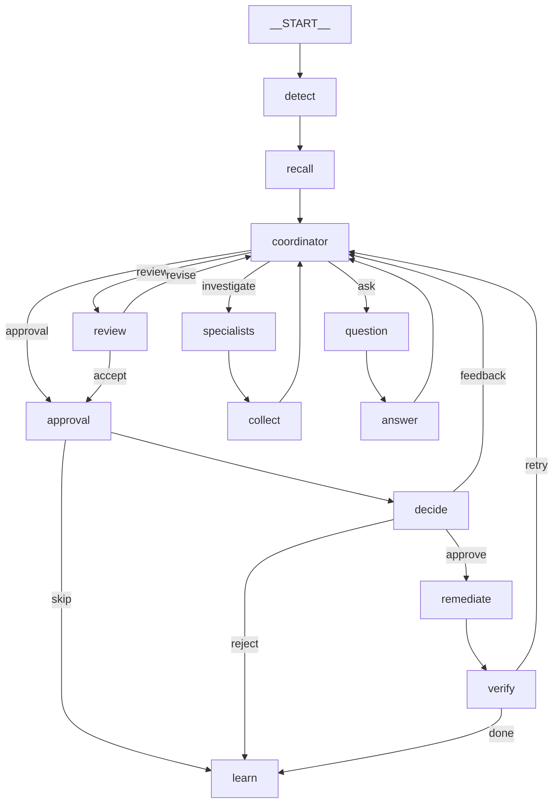

# Cloud-native SRE incident triage agent

A team of LLM agents investigates incidents in the [OpenTelemetry Demo](https://opentelemetry.io/docs/demo/)
shop (v3.1.0, running locally in Docker). It reads live metrics, traces, logs and configuration, finds the root
cause, and proposes a fix. The fix is applied only after a human approves it. The system then checks that the
service recovered, and rolls the fix back if it did not.

The agents are Google ADK `LlmAgent`s and the flow is an ADK `Workflow` graph. Models are reached through
ADK's LiteLLM integration, so any LiteLLM model works. The dashboard is Streamlit. Case state is an ADK session
stored in SQLite. One agent, the review board, is a CrewAI crew that the workflow calls over the A2A protocol.
ADK and CrewAI are the only agent frameworks used.

## What happens in one incident

1. A fault is injected into the shop (or a real one happens). Prometheus rules raise an alert.
2. The alert appears in the dashboard inbox on the **Incidents** page. The operator clicks Investigate.
3. `detect` scans every service against its healthy baseline. `recall` looks for similar past incidents.
4. The **coordinator** agent decides what to do: investigate, ask the operator a question, or conclude.
5. To investigate, it hands 1-3 tasks to specialist agents. They run in parallel. Each one calls read-only MCP
   tools and ends with a finding that cites evidence IDs.
6. The coordinator reads the findings and writes a report: root cause, evidence, and at most one fix (plus an
   optional alternative). Code checks that the cited evidence exists and that the fix is on the allowlist.
7. A **CrewAI review board** (a separate service, called over A2A) audits the report. It can send the work back once.
8. The workflow stops and waits for a human. The operator approves, picks the alternative, rejects, or rejects
   with feedback (which starts a new investigation).
9. After approval, `remediate` applies the fix and `verify` compares the affected services with the baseline.
   If they did not recover, the fix is rolled back and the coordinator gets one more try.
10. `learn` stores the incident in long-term memory, but only when the fix was verified.

## The workflow graph



`uv run sre-triage graph` prints this diagram from the ADK `Workflow` definition. The **Inside ADK** page of the
dashboard also shows it.

| Node | What it does | Kind |
|---|---|---|
| `detect` | Scans RED metrics (rate, errors, latency) of every service, incident window vs baseline. Reads firing alerts | code |
| `recall` | Searches memory for similar past incidents | memory |
| `coordinator` | Each turn it calls one submit tool: `submit_plan` (investigate), `submit_question` (ask), or `submit_report` (conclude). That choice is the route | LLM agent |
| `specialists` | One agent per task, run in parallel (ADK parallel worker): `metrics`, `traces`, `logs_changes`, `infra`. Each runs a ReAct tool loop and ends with `submit_finding` | LLM agents + MCP tools |
| `collect` | Joins the parallel results: findings and evidence go into the shared state | code |
| `question`, `answer` | Ask the operator a question and wait. The answer goes back to the coordinator | human |
| `review` | Sends the report and evidence to the CrewAI review board over A2A. If the service is not configured or fails, a local critic agent reviews instead. The verdict is `accept` or `revise` | A2A (or LLM agent) |
| `approval`, `decide` | Pause with an ADK `RequestInput` until the operator answers. The case is in SQLite, so approval can come later from the CLI or the dashboard | human |
| `remediate` | Validates the action again, runs it, and records how to undo it | code |
| `verify` | Waits (75 s by default), compares watched services with the baseline, looks up to two more times, then rolls back if not recovered | code |
| `learn` | Writes the incident to memory if the fix was verified | memory |

Loops are bounded: at most 3 investigation rounds (`SRE_MAX_ROUNDS`), one review revision, one operator
feedback round, one retry after a failed fix, and one question to the operator.

A second mode, `single`, runs one agent with all 16 tools and no review. It is the baseline for the evaluation.

## Course requirements and where they are met

| # | Requirement | How this project meets it | Files |
|---|---|---|---|
| 1 | Context sharing and state | All nodes read and write one ADK session state: `anomalies`, `alerts`, `memories`, `hypotheses`, `findings`, `evidence`, `report`, `critiques`, `decision`, `outcome` and more. Specialist results flow to the coordinator through `collect`; the report flows to the reviewer and the approval step | `workflow.py`, `adk_view.py` |
| 2 | Tools through MCP | Two MCP servers, `telemetry` (11 tools) and `ops` (5 tools), 16 read-only tools in total. Agents use them through ADK `McpToolset` over streamable HTTP | `mcp_servers.py`, `tools.py`, `agents.py` |
| 3 | Structured output with Pydantic | Every agent answer is a Pydantic model (`Plan`, `Finding`, `Question`, `Report`, `Critique`). Invalid answers go back to the model. Every tool result has a typed model in `tools.py`. The final report is shown as a structured view in the dashboard and as JSON in the CLI | `schemas.py`, `agents.py`, `tools.py`, `ui.py` |
| 4 | Agentic design patterns | Coordinator / router (routes in the graph), parallel fan-out (specialists), reflection (review loop), human in the loop (approval), ReAct (specialists), retry after a failed fix, and a single-agent baseline | `workflow.py`, `agents.py` |
| 5 | Monitoring with callbacks | ADK plugin `ActivityLog` logs every agent start and finish, tool call, validation result, model thought, token use and error. Agent-level callbacks are `before_model_callback` (step limit) and `after_tool_callback` (tool-output checks) | `callbacks.py`, `agents.py` |
| 6 | A2A between ADK and CrewAI | The ADK workflow calls a CrewAI crew through `RemoteA2aAgent`. The crew is served over A2A by its own service. The answer is validated against `Critique` | `workflow.py`, `a2a_critic.py`, `services/crew_reviewer/` |
| 7 | Frameworks | Only ADK and CrewAI. CrewAI lives in its own Python environment, because the two cannot share one | `pyproject.toml`, `services/crew_reviewer/pyproject.toml` |
| 8 | Security and guardrails | See the guardrails section below: input screening, tool-output checks, evidence checks, remediation allowlist, human approval, rollback | `guardrails.py`, `remediation.py`, `agents.py` |
| 9 | Observability and tracing | Langfuse SDK. ADK's OpenTelemetry spans (nodes, agents, model calls with tokens, tools) are exported. Each case is one Langfuse session, each model call carries the model that answered and its cost, and outcome, evaluation and operator ratings are sent as scores. Active once the `LANGFUSE_*` keys are set | `tracing.py`, `callbacks.py` |
| 10 | Evaluation | `sre-triage eval --suite quick` or `full` measures performance, cost and running time and writes `data/eval/<run>/report.md` | `evaluation.py`, `cli.py` |
| 11 | Deployment | `compose.yaml` runs the dashboard, the MCP servers and the reviewer as containers next to the demo on one VM. Built and run locally. The target is a GCP Compute Engine VM. **The cloud deployment has not been done yet** | `compose.yaml`, `Dockerfile`, `services/crew_reviewer/Dockerfile` |

## Setup and run

You need Docker (with Compose), [`uv`](https://docs.astral.sh/uv/), Python 3.12 or newer, and at least one
model API key.

```bash
cp .env.example .env              # add GOOGLE_API_KEY (GROQ_API_KEY and OPENROUTER_API_KEY are optional)
infra/sre/demo.sh up              # clones the demo (tag 3.1.0) on first use, starts it, shop on http://localhost:8090
uv sync --extra dev
uv run sre-triage doctor          # checks backends, MCP servers, reviewer, tracing, model keys
scripts/start.sh                  # the full local stack
```

`scripts/start.sh` starts the demo if Prometheus is not running, runs `uv sync` for both projects, and starts:

Ports: shop 8090 (`SRE_SHOP_PORT`), dashboard 8501, MCP servers 8011 (`telemetry`) and 8012 (`ops`), CrewAI
review board 8002 (A2A).

**Minimal path:** `uv run sre-triage ui` alone works. The two MCP servers then start inside the app process
(still real MCP over loopback HTTP) and the local critic agent reviews reports. Set `SRE_MCP_URL` and
`SRE_REVIEWER_A2A_URL` (see `.env.example`) to use external services.

To try it: open the dashboard, go to **Fault lab**, pick a scenario and inject it. Wait for the alert on the
**Incidents** page and click Investigate. Approve or reject the proposed fix. The Fault lab can reset the shop.
From the terminal: `uv run sre-triage demo cart_cpu_limit` does the whole cycle with automatic approval.

## CLI reference

`uv run sre-triage <command>`

| Command | What it does |
|---|---|
| `doctor` | Check backends, MCP servers, review board, tracing and model keys |
| `health` | Anomaly scan of the last 3 minutes vs the healthy baseline |
| `alerts [--watch]` | Pending and firing alerts. `--watch` offers to investigate new ones |
| `scenarios` | Print the fault catalog |
| `inject <scenario>` or `--random SEED` | Inject a catalog scenario or a generated one (`--difficulty`) |
| `reset` | Restore the standard configuration (flags, limits, stopped or paused containers) |
| `probe` | Inject each scenario, check that it raises an alert, then reset |
| `investigate "<symptom>"` | Run a case in the terminal (`--since`, `--mode multi\|single`, `--model`, `--auto approve\|reject`) |
| `decide <case>` | Approve or reject a waiting case (`--reject`, `--feedback`, `--choice 1\|2`) |
| `answer <case> "<text>"` | Answer a question the coordinator asked |
| `demo <scenario>` | Inject, wait for the alert, investigate, approve, verify, reset (`--variant`) |
| `eval` | Run an evaluation suite (see Evaluation) |
| `memory` | List long-term incident memory |
| `mcp` | Serve the two MCP servers (`--host`, `--port`, default 8011; ops uses port+1) |
| `reviewer` | Serve the CrewAI review board over A2A (`--port`, default 8002) |
| `graph` | Print the workflow graph as Mermaid |
| `ui` | Start the Streamlit dashboard |

## Fault scenarios

`simulator.py` is for the operator only. The agents never see it. It makes real changes to the running demo, the
way an operator would: it lowers a container CPU or memory limit, stops or pauses a container (Docker API), or
edits a feature flag in the flagd file. The agents find these as configuration drift and symptoms.

- **Catalog:** 16 curated scenarios (below), including decoys and healthy controls.
- **Generator:** `inject --random SEED` or `eval --generated N` builds reproducible scenarios from a seed:
  fault kind, valid target and intensity. Difficulty adds harmless decoy changes. About one in six is a control.
- **Decoys:** harmless changes (a PII logging flag, a mild CPU limit on an unrelated service) that a good
  diagnosis must not blame.
- **Healthy controls:** no fault, or only decoys. The right answer is "no incident" and no action.
- **Ground truth:** derived from the fault itself. It holds accepted services, accepted categories and accepted
  fixes, so more than one answer can be correct (for example, `start_service` or `restart_service` for a stopped
  container). `score()` marks service, category and fix correct or not.
- **`sre-triage probe`** waits until no alert is active, injects a scenario, waits for a new alert to fire on
  the affected path, and resets. A pending alert does not count, because it may clear. Run it to see which
  scenarios really raise an alert on your machine. It writes `data/sim/calibration.json`.

| Scenario | Level | Fault | Expected diagnosis |
|---|---|---|---|
| `cart_cpu_limit` | easy | cart CPU limit cut to 0.02 | cart / cpu_limit |
| `cart_cpu_limit_decoys` | medium | same, plus two unrelated changes | cart / cpu_limit |
| `payment_failure` | easy | flag `paymentFailure` 50% | payment / dependency_errors |
| `payment_unreachable` | medium | flag `paymentUnreachable` | payment / dependency_unavailable |
| `cart_failure` | medium | flag `cartFailure` 100% | cart / dependency_errors |
| `catalog_failure` | easy | flag `productCatalogFailure` | product-catalog / dependency_errors |
| `catalog_lock_contention` | hard | flag `productCatalogLockContention` | product-catalog / lock_contention |
| `ad_high_cpu` | medium | flag `adHighCpu` | ad / cpu_saturation |
| `email_memory_leak` | hard | flag `emailMemoryLeak` 1000x | email / memory_exhaustion |
| `recommendation_cache` | hard | flag `recommendationCacheFailure` | recommendation / cache_failure |
| `frontend_traffic_spike` | medium | flag `loadGeneratorFloodHomepage` | frontend / traffic_spike |
| `payment_memory_limit` | medium | payment memory limit 48 MiB | payment / memory_limit |
| `currency_paused` | medium | currency container paused | currency / service_down |
| `valkey_cart_stopped` | hard | valkey-cart container stopped | valkey-cart / service_down |
| `healthy_control` | easy | none | no incident |
| `config_change_control` | medium | only harmless changes | no incident |

## Tools, remediation, guardrails and memory

### MCP tools (read-only)

Every tool compares the incident window with the healthy baseline. The agents send the window in the
`x-incident-window` header, so the model never handles timestamps.

- `telemetry` server (Prometheus, Jaeger, OpenSearch), 11 tools: `service_health`, `downstream_health`,
  `metric_timeline`, `container_resources`, `slow_traces`, `error_traces`, `get_trace`, `search_logs`,
  `datastore_health`, `service_map`, `active_alerts`. They return rate, error ratio and latency (incident vs
  baseline), CPU and memory against limits, trace breakdowns, log lines, data store health, observed call
  graph and alerts.
- `ops` server (Docker, flagd, runbooks), 5 tools: `recent_changes` (configuration that differs from the standard
  setup, plus container events), `container_status` (state, restarts, OOM kills, limits), `container_logs`,
  `list_feature_flags` (current vs standard value), `search_runbooks` (keyword search in `runbooks/`).

Each specialist gets a subset (`AGENT_TOOLS` in `tools.py`). Each tool call becomes an evidence record with an ID
such as `M1` or `T2`. Agents must cite these IDs.

### Remediation actions

Agents only propose. `remediation.py` validates, describes, executes and rolls back.

| Action | Risk | Limits |
|---|---|---|
| `set_feature_flag` | low | may only turn a known flag off; can restart the service after |
| `set_cpu_limit` | low | app services only, 0.25 to 2.0 CPUs |
| `set_memory_limit` | low | app services only, from the standard limit up to 4x it; starts the container again if it was killed |
| `start_service` | low | known service or data store |
| `unpause_service` | low | known service or data store |
| `restart_service` | medium | known service or data store; drops in-flight requests |

### Guardrails

| Where | What |
|---|---|
| Input (`Guardrails` ADK plugin) | Every user message (the alert text and operator feedback) is screened before any agent runs. Regex rules catch prompt injection and toxic language. An optional LLM classifier is the second stage (`SRE_SCREEN_WITH_LLM`). If the classifier fails, the regex result stands. A blocked case stops and the block is logged |
| Tool output (agent callback) | Each result is type-checked against its Pydantic model, PII is redacted (emails, card numbers, secret-looking keys), instruction-like text is cut out, and the size is capped |
| Agent answers (`submit_*` tools) | Schema check, cited evidence IDs must exist, a diagnosis must cite evidence, the fix must pass the allowlist. Errors go back to the model. A failed check also forces a `revise` verdict at review |
| Step limit | After the tool budget (5 calls per specialist) the agent may only call its submit tool |
| Remediation | Allowlist and bounds (above), validated again right before execution |
| Human approval | Nothing runs without an operator decision. The operator sees the risk and the review board's risk note |
| Rollback | If `verify` finds the services not recovered, the change is undone |

`tests/data/guardrail_prompts.jsonl` holds labelled prompts. `eval` scores the input screen on them and adds
precision and recall to the report.

### Memory

Long-term memory uses ADK `SqliteMemoryService` in `data/memory.sqlite`, seeded from `seeds/incidents.json`.
The `recall` node searches it, and the coordinator can search it with ADK's `load_memory` tool. Only verified
fixes (outcome `resolved`) are stored. Operator ratings from the **Memory & feedback** tab are added to the
stored text, so later agents see them. Set `SRE_MEMORY=off` for no recall and no learning. Evaluation runs use
their own memory file inside the run directory, so they never touch `data/memory.sqlite`.

## Observability

- **Prometheus rules** (`infra/sre/prometheus/rules.yml`): recording rules compute rate, error ratio and p50/p95
  latency per service. A "healthy" series keeps samples only while no alert fires, for 10 minutes after the last
  one cleared, and only while all 15 shop containers run. The baseline is the 6-hour median of that series, so
  an incident, a recovery or a half-started shop does not pollute it.
- **Alert rules:** `ServiceHighLatency`, `ServiceHighErrorRate`, `ServiceTrafficDrop`, `ServiceTrafficSpike`,
  `ContainerDown`, `ContainerRestarted`, `ContainerCpuThrottled`, `ContainerMemoryNearLimit`. Three were tuned
  on the healthy shop:
  - Latency: busy services (0.5 requests/s or more) are judged on the p95, quiet ones on the median. With a few
    requests a minute the p95 is the single slowest request, and healthy checkout jumps from 100 to 350 ms.
    `compare_red` in `tools.py` applies the same rule in `detect` and `verify`.
  - CPU throttling: needs 20% of periods throttled and 8% of wall time lost. Healthy payment is throttled in
    15 to 25% of periods but loses under 5% of wall time.
  - Memory near limit: cart is left out. Its .NET runtime normally sits at about 97% of the limit.
- **Demo overlay** (`infra/sre/compose.sre.yaml`): gives every app container a 1.0 CPU limit and raises three
  upstream memory limits (checkout, product-catalog, payment). They were so tight that garbage collection or
  kernel memory reclaim made the healthy shop slow and noisy.
- **`infra/sre/standard.json`** records the standard CPU and memory limits and the original flag file. It is
  written by `infra/sre/demo.sh standard`. `reset`, `recent_changes` and remediation use it.
- **Langfuse** (`tracing.py`, about 80 lines on the Langfuse SDK): set `LANGFUSE_PUBLIC_KEY`,
  `LANGFUSE_SECRET_KEY` and `LANGFUSE_BASE_URL` in `.env`. Without keys nothing is exported. `doctor` shows
  whether it is on, and a finished case links to its trace in the dashboard.
  - ADK already creates a span for every workflow node, agent, model call and tool call. The SDK exports them.
    Duplicate and transport spans are dropped (ADK's inner `generate_content` span, the MCP and A2A clients'
    own spans), so tokens are counted once.
  - Each run of a case is one trace under a root observation `incident_triage` (input: the symptom, output: the
    report). The case id is the Langfuse session, so the first run and every resume after a human decision are
    shown together. Tags: mode, source, scenario.
  - Each model call records the model of the fallback chain that really answered and its list price, so
    Langfuse's token and cost totals match the app's own numbers.
  - Scores: `status` and `guardrail_hits` for every run, the five correctness scores from `sre-triage eval`,
    and `operator_rating` when the operator rates the diagnosis in the dashboard.
  - The CrewAI review board runs in another process. Its review is recorded as one generation
    (`crew_reviewer`) with the model, tokens and cost the board reports back over A2A.
  - Tool results are traced after the guardrail has checked and redacted them.
- **Activity log:** the dashboard and CLI show every agent, tool call and decision live (`ActivityLog` plugin).

## Evaluation

```bash
uv run sre-triage eval --suite quick
```

Each run waits until no alert is active, injects a fault, waits for a new alert to fire, investigates, approves,
verifies and resets. Nobody has to be at the keyboard. "Detected" means a new alert reached the firing state.
On a laptop, start a long run under `systemd-inhibit --what=idle:sleep` so the machine does not suspend.

Options: `--suite smoke|quick|full` (smoke: 2 runs; quick: 9 runs, 5 scenarios multi, the healthy control and
3 single; full: 44 runs, every scenario multi and single plus ablations), `--runs a:multi,b:single` (explicit
pairs), `--generated N --seed S` (add generated scenarios), `--wait` (longest wait for an alert, default 120 s),
`--resume RUN_ID` (continue an interrupted run).

Variants: `multi`, `single` (one agent, no review), `multi+memory` (memory on, run twice to see recall), and
`multi-no-review` (no CrewAI board; the local critic still runs).

Measured per run:

- **Performance:** right service, right category, accepted fix, recovered, detected, false alarms, healthy controls left clean.
- **Cost:** LLM calls, tokens in and out, USD per incident. USD is the list-price equivalent from LiteLLM's price
  table. Free-tier calls count as zero here, and models without a price count as zero.
- **Running time:** detect, diagnose, recover and total seconds (mean and median).

Output goes to `data/eval/<YYYYMMDD-HHMMSS>-<suite>/`: `results.jsonl` (one line per run), `suite.json`,
`summary.json` and `report.md` (performance, cost, time, per-scenario table, multi vs single, ablations,
guardrail precision and recall). The **Evaluation** page of the dashboard reads the same files.

### Results (quick suite, 13 November 2026)

One run per scenario on a laptop, models from the free-tier fallback chain, CrewAI review board on. This is a
small sample: it shows that the whole loop works, not a statistically firm rate.

| Variant | Runs | Correct diagnosis | Fix accepted | Recovered | Detected by an alert | Healthy control left clean |
|---|---|---|---|---|---|---|
| multi-agent | 6 (5 faults, 1 control) | 100% | 100% | 100% | 100% | yes |
| single agent | 3 faults | 100% | 100% | 100% | 67% | - |

| Variant | LLM calls / incident | Tokens in / out | USD / incident | Detect | Diagnose | Recover | Total |
|---|---|---|---|---|---|---|---|
| multi-agent | 18.3 | 50,600 / 4,994 | 0.067 | 88 s | 175 s | 76 s | 343 s |
| single agent | 8.7 | 41,807 / 508 | 0.014 | 55 s | 80 s | 75 s | 286 s |

- On the three scenarios both variants ran, both were correct. The multi-agent variant used 2.3 times the calls
  and 8.5 times the cost (0.118 against 0.014 USD) for an 11% longer run. Its advantage on these easy
  scenarios is the independent review, not accuracy.
- All 5 multi-agent fault reports were reviewed by the CrewAI board over A2A (7 reviews, no fallback to the
  local critic). Two reports were sent back once and accepted after revision.
- In one single-agent run (`payment_failure`) no alert fired within the 240 s wait. The case was opened anyway
  and diagnosed correctly.
- Input guardrail on 101 labelled prompts: precision 1.0, recall 0.91 (27 of 30 prompt injections and 13 of 14
  toxic prompts stopped, no false positives on 57 normal prompts).
- Total list-price cost of the suite: 0.44 USD.

Alert calibration (`sre-triage probe`, one injection per scenario): 11 of 14 fault scenarios raise a firing
alert within 20 to 140 s, and both healthy controls raise none. Three slow-burn faults
(`catalog_lock_contention`, `email_memory_leak`, `recommendation_cache`) raised no alert even after 600 s on
this low-traffic demo. They can still be investigated when an operator opens the case.

Run it yourself with `uv run sre-triage eval --suite quick`. The report is `data/eval/<run>/report.md`.

## Deployment on GCP (containers tested locally, cloud not done yet)

`compose.yaml` runs the dashboard, the MCP servers and the CrewAI review board as three containers next to the
demo. This was built and run on the development machine: `doctor` passes inside the dashboard container and a
full fault scenario ran from it. The same steps on a VM are the cloud deployment. They have not been run on GCP.

```bash
# 1. VM: 4 vCPU, 16 GB, 60 GB disk. No firewall rule is needed, the dashboard is reached through SSH.
gcloud compute instances create sre-triage --zone=europe-west1-b --machine-type=e2-standard-4 \
  --image-family=ubuntu-2404-lts-amd64 --image-project=ubuntu-os-cloud --boot-disk-size=60GB \
  --scopes=cloud-platform
gcloud compute ssh sre-triage --zone=europe-west1-b

# 2. On the VM: Docker, the code, the keys
curl -fsSL https://get.docker.com | sudo sh && sudo usermod -aG docker $USER && newgrp docker
git clone https://github.com/lazinWolf/SRE-triad-agent.git sre-triage && cd sre-triage
cp .env.example .env && nano .env            # model keys, LANGFUSE_* keys

# 3. The shop with its observability stack (about 25 containers, several minutes on the first start)
infra/sre/demo.sh up

# 4. The triage app
docker compose up --build -d
docker compose exec triage-ui sre-triage doctor

# 5. From your own machine: open the dashboard through an SSH tunnel, then http://localhost:8501
gcloud compute ssh sre-triage --zone=europe-west1-b -- -L 8501:localhost:8501
```

- Do not open port 8501 to the internet. The dashboard has no login and the app can change containers through
  the Docker socket. `compose.yaml` binds it to `127.0.0.1` for this reason.
- The MCP servers are only reachable inside the Docker network. The reviewer shares the dashboard's network
  namespace, so ADK reaches its agent card on loopback.
- After a VM restart run `infra/sre/demo.sh up` again. Most demo containers do not restart by themselves.
- Stop the VM when it is not used (`gcloud compute instances stop sre-triage --zone=europe-west1-b`).
- Wait about ten minutes after the first start before running a case. The alert rules need a healthy baseline.
- Models from Google Cloud (Vertex AI) instead of the free AI Studio keys: give the VM's service account the
  Vertex AI User role and set `SRE_MODEL=vertex_ai/gemini-3.5-flash`, `VERTEXAI_PROJECT` and
  `VERTEXAI_LOCATION` in `.env`. No key file is needed on the VM (`--scopes=cloud-platform` above lets the
  containers use the VM's identity). LiteLLM supports this, but it has not been tried in this project yet.
- To look at the shop itself, add `-L 8090:localhost:8090` to the tunnel command.
- Why not Cloud Run: the app needs the Docker socket, the flagd flag file and the demo's containers next to it.

## Tests

```bash
uv run pytest -q
```

The suite is offline. It needs no Docker and no API keys. A scripted ADK model (`tests/fakes.py`) and fake
telemetry backends let the whole graph run for real: tools execute, the MCP servers run over loopback, and the
dashboard pages render with the Streamlit test runner. It covers the full flow (approval, fix, verify, learn),
the review loop, rejection with feedback, operator questions, failed fix and rollback, invalid submissions,
guardrails, memory on and off, the A2A fallback, callbacks, the simulator and its scoring, and the evaluation
run, resume and report. The CrewAI service is not started by the tests.

## Repository layout

```
src/sre_triage/
  workflow.py      ADK Workflow: nodes, routes, parallel specialists, approval, SQLite sessions
  agents.py        ADK LlmAgents, MCP toolsets, validating submit_* tools, step limit, tool-output callback
  prompts.py, schemas.py   Agent prompts; Pydantic models of agent answers
  tools.py         The 16 read-only tools, typed results, evidence records, anomaly scan
  mcp_servers.py   The telemetry and ops MCP servers (also started embedded)
  telemetry.py     Clients for Prometheus, Jaeger, OpenSearch, Docker and flagd
  guardrails.py    Input screening plugin, PII redaction, tool-output checks
  remediation.py   Allowlist, risk, execute, rollback
  callbacks.py     ActivityLog plugin: activity, usage and cost
  tracing.py       Langfuse tracing: sessions, model cost, scores
  memory.py        Long-term memory on ADK SqliteMemoryService
  a2a_critic.py    A2A client helpers and Pydantic check of the review answer
  llm.py           FallbackLlm: ADK LiteLlm models with a fallback chain
  simulator.py, evaluation.py   Fault lab and ground truth; suites, metrics, report
  cases.py, adk_view.py   Case records and activity log (data/cases/); ADK session read-back
  config.py, cli.py, ui.py   Settings; terminal and Streamlit front ends
services/crew_reviewer/   CrewAI review board served over A2A (own uv project and Dockerfile)
infra/sre/        Demo overlay: compose.sre.yaml, demo.sh, Prometheus rules, standard.json
infra/otel-demo/  The OpenTelemetry Demo clone (created by demo.sh, not committed)
runbooks/, seeds/ Runbooks the agents search; seed incidents for memory
scripts/start.sh, compose.yaml, Dockerfile   Local stack start; the app next to the demo
tests/            Offline tests and the guardrail prompt set
data/             Cases, sessions, memory, evaluation output (not committed)
```

## Known limits

- Free-tier model rate limits make runs slow. A model that is rate-limited is skipped for a while and the next
  one in `SRE_FALLBACK_MODELS` serves the call. The CrewAI review board walks the same chain, with at most 100 s
  per model and 240 s per review. If no model answers, the local critic reviews instead.
- Some scenarios may not raise an alert on every machine. Use `sre-triage probe` to check.
- The demo shop has little traffic (checkout and payment get about 8 requests a minute). A fault that only
  adds tail latency to such a quiet service is not detected. Other heavy workloads on the same machine make
  latency noisy and can raise alerts on a healthy shop.
- After a reboot only some demo containers come back. Run `infra/sre/demo.sh up` again. The baseline ignores
  the time the shop was not whole.
- The cloud deployment has not been done yet.
- The agents can only change what the six allowlisted actions allow, and only on the demo's containers.
