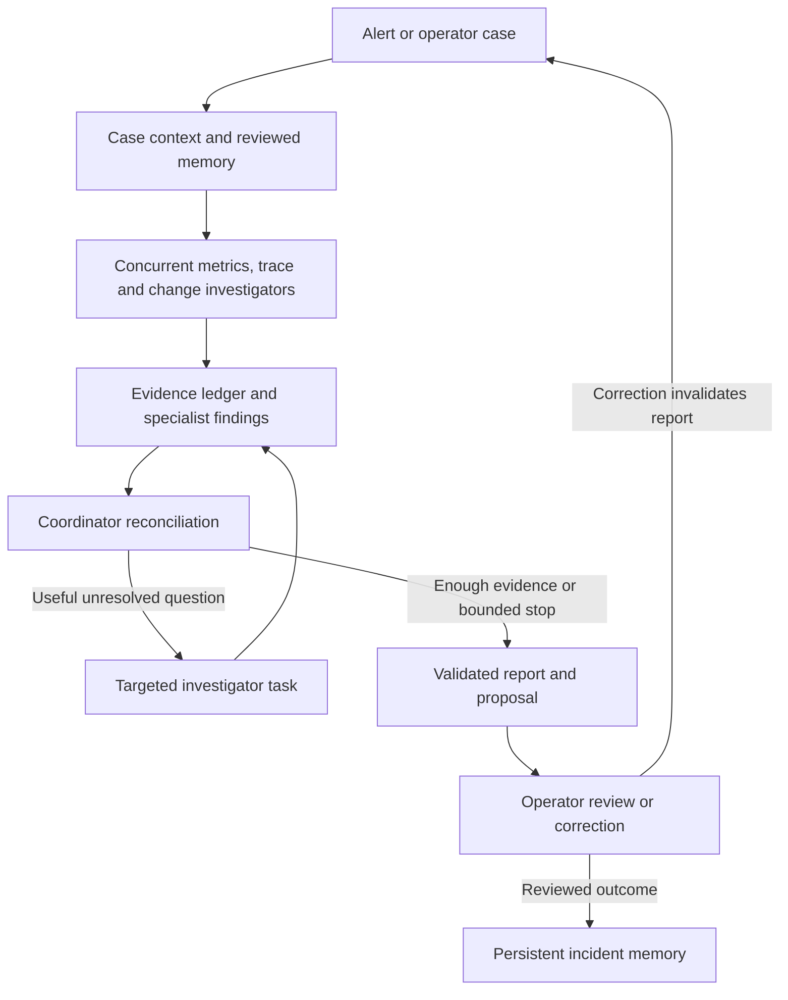

# Stage 1 architecture and decisions

## Investigation path

The operator API maintains workflow status and starts one investigation at a time per case. Initial investigations run concurrently; follow-ups run sequentially and receive shared findings. A supported conclusion is still a hypothesis supported by observations, not a proven exclusive root cause.

## Application and evidence

Checkout calls inventory over HTTP with propagated W3C trace context. Inventory has an actual bounded worker pool. A capacity configuration change is audited before/after, while requests record completion time, latency, queue wait and observed worker slots. OpenTelemetry spans record the request path and processing attributes.

Observations are age/count bounded and report retention, truncation and window coverage. Metrics include historical request summaries plus explicitly timestamped current resource fields. Investigators must not treat current fields as historical values. Completion-based throughput can fall because of queueing; it is not a direct measurement of offered demand.

Tools use fixed endpoints and configured service identities. Queries must remain inside the case window and cannot exceed one hour. Returned evidence stores query arguments, source, status, collector, timestamps and a unique ID. Raw evidence is retained alongside interpretations.

The toolkit does not expose operator fault controls, evaluation ground truth, arbitrary URLs, filesystem access, shell commands or remediation execution. Telemetry and retrieved records are treated as data in agent instructions.

## ADK implementation

The tree contains three `LlmAgent` investigators inside a `ParallelAgent`, plus a schema-constrained coordinator `LlmAgent`, orchestrated by a small custom `BaseAgent` workflow. Investigator outputs use distinct session keys; the coordinator gets the reconciled evidence snapshot. Tool evidence writes go through serialized SQLite transactions.

Google ADK 2.11 also offers graph and dynamic workflows. For this initial integration, the existing agent templates keep the three-investigator tree and bounded conditional loop small and testable. `ParallelAgent` emits a deprecation warning. The dependency is pinned; reassess the native graph workflow before Stage 2 expansion rather than carrying the template indefinitely. See [ADK custom workflow guidance](https://adk.dev/agents/custom-agents/) and [graph workflows](https://adk.dev/workflows/graphs/).

The ADK session service is in memory for one invocation. Durable case state and reviewed memory are application-managed SQLite records. A new run reconstructs context from the case, corrections and relevant reviewed incidents, rather than resuming an entire prior model transcript. Persistent ADK sessions and ADK memory services can be evaluated later if needed.

## Bounded behavior

- At most 24 telemetry attempts per run, shared across investigators.
- At most 24 model calls and 90 seconds per investigation.
- At most two targeted follow-up rounds, with up to three tasks per decision.
- Repeated identical successful or missing queries return cached evidence within a run.
- All unavailable, missing, malformed and unsupported responses remain explicit.
- Timeout, cancellation, exhausted follow-up, or invalid report preserves an unresolved result and the collected evidence.

The bounds are configurable through the Python investigation interface where exposed; the operator API uses the defaults above. Report validation checks current-run citations, allowed services and minimum source diversity for supported hypotheses. It cannot establish the semantic truth of a causal claim; live evaluation and operator review remain necessary.

## Feedback, memory and recovery

Corrections are saved immediately after a run, increment the case revision and clear the old report. A new run includes the corrections but creates a fresh evidence set. Reports cannot cite previous-run evidence accidentally. Corrections during an active run are deferred by the API.

Memory is populated only by an explicit operator review. Each entry carries source case, revision, origin mode, outcome and evidence IDs. Retrieval currently matches affected service and excludes the current case. An unresolved incident can be retained with unknown cause. More selective relevance, version/freshness checks and retraction policies are future work.

Recommendations are not executed. An operator-reported `resolved` outcome describes reported recovery; it neither confirms a cause nor proves automated verification. Recovery checks need a new observation window and meaningful traffic. Adding action tools will require approval tied to an exact proposal and a separate recovery state machine.

## What replay establishes

Replay is a deterministic `BaseLlm` implementation running inside the same ADK `LlmAgent` tree. It emits actual function calls through ADK and consumes tool results from the running application. It requests a before/after metrics comparison when the retrieved audit history contains a capacity reduction.

Its rule checks queueing changes, available sample counts, and downstream span presence. It does not establish equal offered demand or perform open-ended causal reasoning. Operator corrections conservatively suppress its proposal. This is an orchestration and integration harness; its output must not be scored as an autonomous diagnosis.

## Next checkpoint

Configure a supported model, run the same incident live, inspect every asserted observation against the ledger, provide a meaningful correction, and review how the coordinator's next task changes. That closes the largest remaining Stage 1 uncertainty before adding more faults or operational backends.
